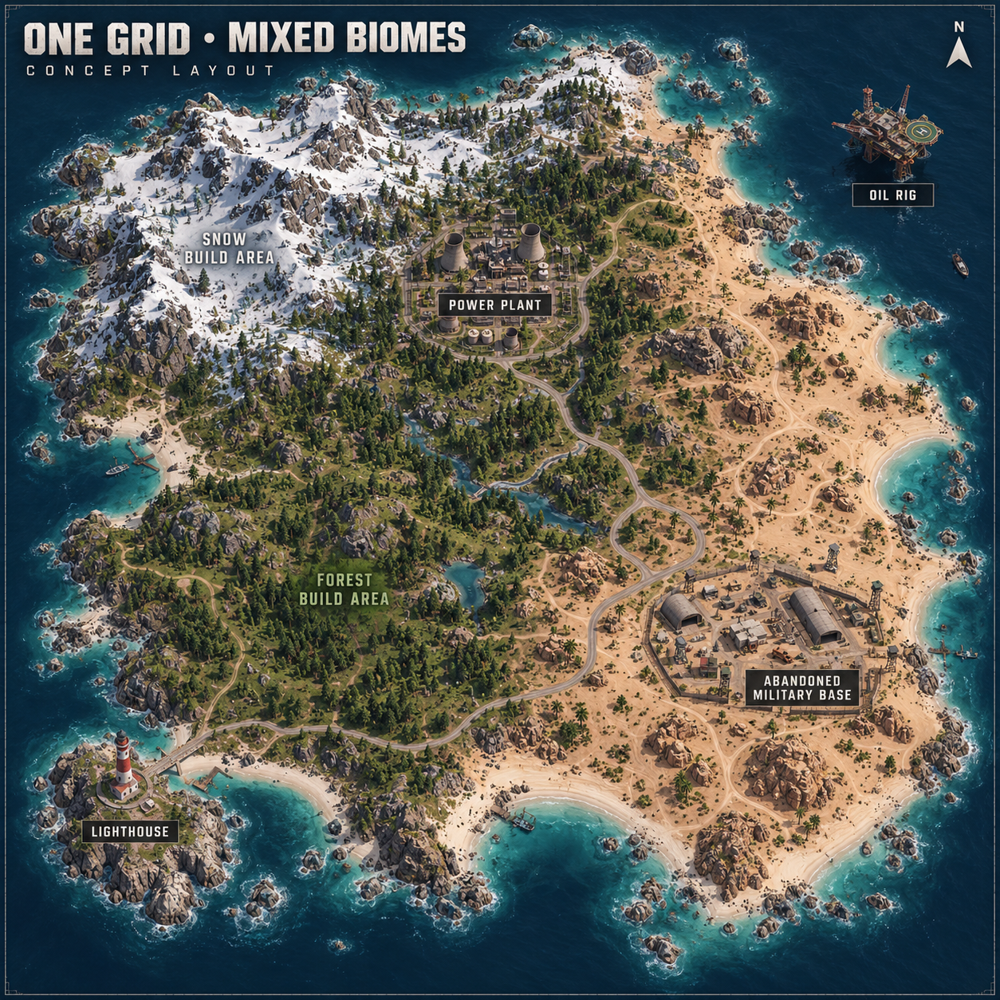

# Mixed-biome Rust map draft

A custom **1,500 × 1,500 metre** Rust island with snowy northwest hills, temperate forest to the west and centre, desert to the east and southeast, and surrounding ocean. This is larger than a literal single map grid so the requested full-size monuments can fit.

The binary map is an experimental editor draft. Its binary structure has been checked; RustEdit loading, terrain integration, monument puzzles, loot, navigation, and gameplay still need validation with the current game.

## Downloads

- [Download the `.map`](https://raw.githubusercontent.com/loexUSA/s/refs/heads/main/onegrid_mixed_draft.map)
- [Download the draft ZIP](https://raw.githubusercontent.com/loexUSA/s/refs/heads/main/downloads/rust_map_draft.zip)
- [Download the complete project ZIP](https://raw.githubusercontent.com/loexUSA/s/refs/heads/main/downloads/rust_project.zip)
- [Browse all repository files](https://github.com/loexUSA/s)

The ZIP contains the map, generator, prefab catalog, map manifest, original notes, and structural verification report. The repository also contains a standalone verifier and both concept images.
The complete project ZIP adds both previews and all server installation and query tools.

## Map layout

| Monument | Placement |
| --- | --- |
| Power Plant | North-central inland area |
| Abandoned Military Base A | Southeast desert |
| Lighthouse | Southwest coast |
| Small Oil Rig | Northeast offshore |

The draft also includes two road paths, initial trees and rocks, 110 initial stone/metal/sulfur nodes, and broad western clearings intended for bases. It excludes Launch Site, Gas Station, Supermarket, and Harbor.



[View the alternative island concept](previews/mixed-biome-island-concept.png). These generated images illustrate the design; they are not screenshots or accurate renders of the `.map`. Their “one grid” labels describe the original concept rather than the draft's actual dimensions.

## Rebuild and inspect

Use Python 3.12 and a system installation of `liblz4` (for example, the `liblz4-1` package on Debian/Ubuntu). The published draft was generated with the NumPy and SciPy versions in `requirements.txt`.

```sh
python3 -m venv .venv
.venv/bin/python -m pip install -r requirements.txt
.venv/bin/python build_map.py
.venv/bin/python verify_map.py onegrid_mixed_draft.map
```

The generator uses a fixed random seed and writes `onegrid_mixed_draft.map` and `map_manifest.json` beside itself. Back up any manual map edits before rebuilding. It writes native asset references and does not redistribute Rust game meshes or textures. `prefab_catalog.json` records the public manifest source for those references.

`verify_map.py` independently checks the Rust World v9 header, legacy LZ4 stream, protobuf structure, seven terrain layers, texture weights, finite prefab transforms, and road nodes. `verification.json` is the saved report for the published draft, including a SHA-256 checksum and a separate prefab catalog check. The CLI verifier checks structure; it does not repeat that separate source-catalog audit. Verification does not prove compatibility with current game assets or working monument gameplay.

## Before running a public server

Open the map in current RustEdit with your Rust game assets. Apply and review native monument terrain stamps; check pivots, basements, entrances, terrain holes, coast access, military base assembly, and monument building exclusion zones. The initial flat pads are approximate. RustEdit extension IO metadata and navigation data are not included.

Then use a current Rust dedicated server to check loading, puzzles, loot, AI navigation, player spawns, build space, and resource respawning. The initial resource placements do not establish a working respawn population. See [MAP_NOTES.txt](MAP_NOTES.txt) for the original draft notes.

Server installation and startup helpers live in [`server/`](server/). SteamCMD downloads the official dedicated server files on the hosting machine; server binaries, saves, logs, and credentials are not committed to this repository. A persistent, publicly reachable server requires an appropriate host and open game ports.
